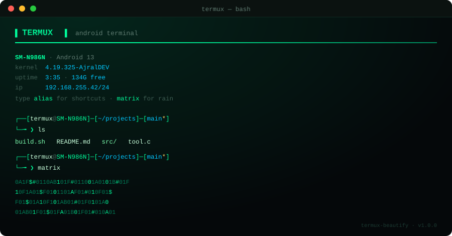
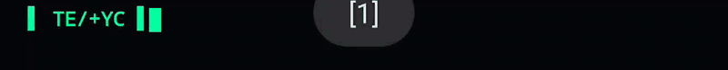

<div align="center">



# Termux Beautify

**Turn plain Termux into a modern hacker terminal.** Adaptive login banner, phosphor-green theme, two-line prompt with git branch, sensible aliases, extra key row, and a `matrix` easter egg.

[](install.sh)
[](#requirements)
[](#what-you-get)
[](LICENSE)



</div>

---

## Install

```bash
curl -fsSL https://raw.githubusercontent.com/JackRipper-ID/termux-beautify/main/install.sh | bash
```

Preview the changes without touching anything:

```bash
bash install.sh --dry-run
```

Open a new Termux session (or restart the app) and the new look is live.

---

## What you get

| | Change | Where |
|---|---|---|
| 🖥 | **New login banner** — replaces the default "Welcome to Termux" text. Shows the `TERMUX` block art on wide screens and a compact box on narrow ones, plus device, kernel, uptime, storage and Wi-Fi IP | `~/.termux/motd.sh` |
| 🎨 | **Phosphor-green terminal theme** — background, cursor and the full 16-color palette | `~/.termux/colors.properties` |
| ❯ | **Two-line hacker prompt** — `┌──[user@device]─[~/path]─[git branch]` / `└─╼ ❯` | `~/.bashrc` |
| 🌿 | **Git branch + dirty marker** (`*`), and an exit-code marker (`✘ 1`) when a command fails | `~/.bashrc` |
| ⌨️ | **Extra key row** — `ESC / - HOME UP END PGUP` and `TAB CTRL ALT ← ↓ → PGDN` | `~/.termux/termux.properties` |
| ⚡ | **Aliases & history** — `ll`, `la`, `..`, `...`, `update`, `search`, history search with ↑/↓ | `~/.bashrc` |
| 🟩 | **`matrix` easter egg** — green rain, `Ctrl+C` to stop | `~/.bashrc` |

Nothing in `$PREFIX` (the system part of Termux) is modified. Every change lives in your home directory.

Everything is written inside clearly marked blocks:

```bash
# >>> termux-beautify >>>
...
# <<< termux-beautify <<<
```

Re-running the installer replaces those blocks instead of stacking them, so it is safe to run more than once.

---

## Usage

```bash
alias             # list the shortcuts
matrix            # green rain, Ctrl+C to stop
update            # pkg update && pkg upgrade -y
search <query>    # pkg search
```

Preview or reload the banner:

```bash
bash ~/.termux/motd.sh     # render the banner right now
source ~/.bashrc           # reload the prompt
```

Colors and the extra key row need a new session: **open a new session or restart Termux**.

---

## Options

```text
-h, --help            show this help
    --no-packages     skip pkg install
    --no-banner       keep the login banner empty
    --no-anim         no typing/scan animation on login
    --style <s>       banner style: auto (default), line, or art
    --no-matrix       do not add the matrix function
    --keep-colors     keep your current colors.properties
    --uninstall       revert everything
    --dry-run         show what would change, touch nothing
```

Examples:

```bash
bash install.sh --no-packages        # look only, install nothing
bash install.sh --keep-colors        # keep your own color scheme
bash install.sh --dry-run            # safe preview
```

---

## Packages installed

```
git  ncurses-utils  bash-completion  command-not-found  less  nano  iproute2  procps
```

Skip them with `--no-packages` if you prefer a minimal install.

---

## Uninstall

```bash
curl -fsSL https://raw.githubusercontent.com/JackRipper-ID/termux-beautify/main/uninstall.sh | bash
```

The uninstaller restores the **original** `~/.termux/motd.sh` and `colors.properties` from `~/.termux-beautify/original` (or removes them if they did not exist before), then strips the marked blocks from `~/.bashrc` and `termux.properties`. The default Termux banner comes back.

The first backup is never overwritten, so running the installer twice does not replace your originals with a themed copy.

---

## Requirements

- Termux from [F-Droid](https://f-droid.org/packages/com.termux/) or [GitHub releases](https://github.com/termux/termux-app/releases) — not the outdated Play Store build
- Android **aarch64 / ARM64**
- A terminal font with box-drawing and block glyphs — the default Termux font works

---

## Files touched

```text
~/.termux/motd.sh                 login banner (backed up, or removed on uninstall)
~/.termux/colors.properties       terminal palette (backed up if it exists)
~/.termux/termux.properties       extra keys, appended in a marked block
~/.bashrc                         prompt, aliases, functions, marked block
~/.termux-beautify/original/      untouched copies from the first run + state
```

---

## Banner styles

`~/.termux/motd.sh` asks the terminal for its width and picks a size that never wraps:

| Terminal width | Banner |
|---|---|
| **66+ columns** | full 63-column `TERMUX` block art, 6 rows |
| **under 66 columns** | one line: `▌ TERMUX ▌  android terminal` plus a gradient rule (what a phone shows) |

Force one look with `--style line` or `--style art`:

```bash
bash install.sh --style line     # always the one-liner
bash install.sh --style art      # always the block art
bash install.sh --no-anim        # everything at once, no animation
```

---

## Login animation

The banner performs a short sequence (about two seconds), then the session info and prompt appear:

| Step | Effect |
|---|---|
| 1 | the two `▌` brackets pulse dim and bright |
| 2 | `TERMUX` decrypts — random characters lock into place one by one |
| 3 | a glitch flicker before the word settles |
| 4 | `android terminal` types itself out |
| 5 | the gradient rule draws across the screen |
| 6 | a bright segment sweeps the rule, then the gradient is restored |
| 7 | device, kernel, uptime and IP fade in one line at a time |
| 8 | a block cursor blinks once |
| 9 | the shortcut hint types itself |

No animation when output is not a terminal (pipes, scripts), when `TERMUX_BEAUTIFY_ANIM=0` is set, or when installed with `--no-anim`.

Rotate the screen and run `bash ~/.termux/motd.sh` to see the other banner width.

---

## Troubleshooting

| Symptom | Fix |
|---|---|
| Prompt looks right but colors do not | Open a new session, or run `termux-reload-settings` |
| Box drawing looks broken | Use a Nerd/DejaVu-style font in Termux settings |
| Extra keys row missing | `termux-reload-settings`, then restart the app |
| Banner did not change | `bash ~/.termux/motd.sh` to test it, then restart Termux |
| No git branch shown | `pkg install git`, and make sure you are inside a git repo |
| Want the old look back | `bash uninstall.sh`, or restore from `~/.termux-beautify/original` |
| `pkg install` failed | Rerun it manually: `pkg install -y git ncurses-utils bash-completion less nano iproute2 procps` |

---

## Layout

```text
termux-beautify/
├── install.sh      # installer
├── uninstall.sh    # restore everything
├── preview.svg     # README banner
├── demo.gif        # login animation (recording)
└── LICENSE
```

---

<div align="center">
<sub>Built for Termux. Nothing is sent anywhere — every change is a local file edit.</sub>
</div>
